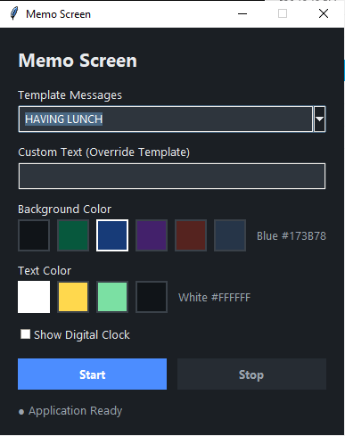

# Memo Screen

Light desktop app (Python/Tkinter) for Windows 10/11 that displays a
fullscreen memo for your co-workers. Tired of answering "Where are you?"
when you're at work? Leave a memo on your screen:
**AT MASJID**, **OUT FOR MEETING**, or **DON'T TURN OFF, SHUT DOWN AUTOMATICALLY**.

> Note: This is not a screensaver

## Feature

- Editable presets (`presets.py`)
- Custom Memo; Overwrite presets
- 6 Background Color and 4 Text Color (editable at `presets.py`)
- Digital clock `HH:MM` optional
- Text size auto adjustment
- Press `ESC` to Stop
- Preference saved to: `%APPDATA%\MemoScreen\config.json`
- No Internet

## Screenshots
Main interface


Screenshot 1


Screenshot 2

## Requirements

- Windows 10/11
- Python 3.11 or newer 

## Run

```bash
python main.py
```

## Usage

1. Select a preset messages in the **Template Messages** dropdown.
2. Optional: Type **Custom Text**. If not empty, message will be shown.
3. Customize Background Color **Background Color** and Text Color **Text Color**.
4. Toogle **Show Digital Clock** if necessary.
5. Press **Start** to display your memo.

To exit fullscreen:

- Press `ESC`

## Create executable windows

```bash
pip install pyinstaller
pyinstaller --noconfirm --clean --windowed --name MemoScreen main.py
```

## Structure

```
Memo Screen/
├── main.py          # window control
├── presets.py       # Text Preset and colors
├── config.py        
├── fullscreen.py    
├── styles.py        
├── tests/           
├── requirements.txt
└── README.md
```

## Limitation

- Support main monitor only
